## LeoDex

I make websites for small businesses: restaurants, hotels, clinics, salons. Built with Next.js.

[leodex.dev](https://leodex.dev) · [Telegram](https://t.me/xeDoeL)

### Projects

<table>
<tr>
<td width="50%" valign="top">
<a href="https://il-faro.vercel.app">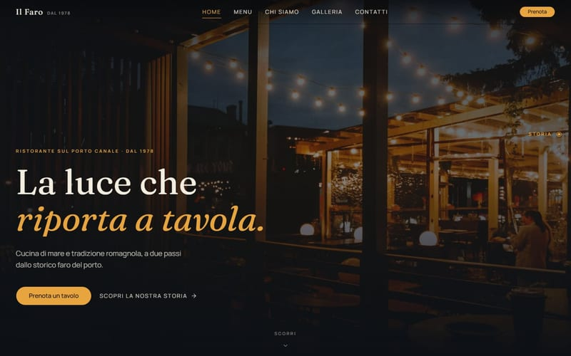</a>
 <b>Il Faro</b> · Seafood restaurant
 <a href="https://il-faro.vercel.app">Site</a> · <a href="https://github.com/LeoDex0/il-faro">Code</a>
</td>
<td width="50%" valign="top">
<a href="https://hotel-site-omega-two.vercel.app">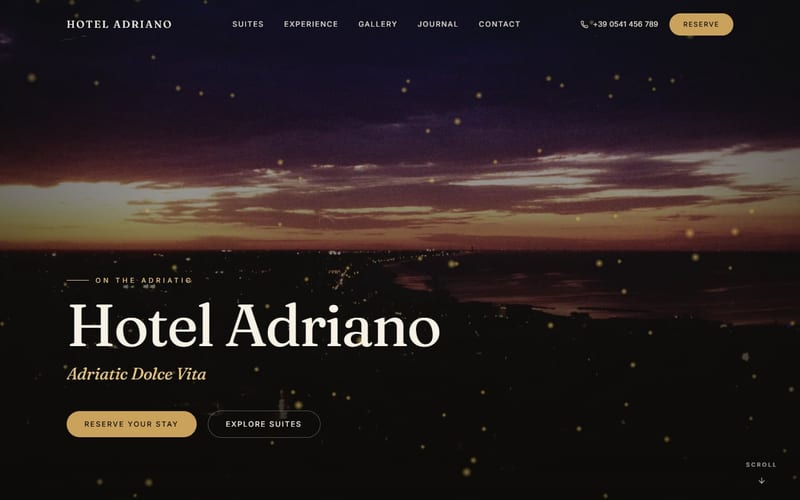</a>
 <b>Hotel Adriano</b> · Boutique hotel
 <a href="https://hotel-site-omega-two.vercel.app">Site</a> · <a href="https://github.com/LeoDex0/hotel-adriano">Code</a>
</td>
</tr>
<tr>
<td width="50%" valign="top">
<a href="https://palyanytsya-trattoria.vercel.app">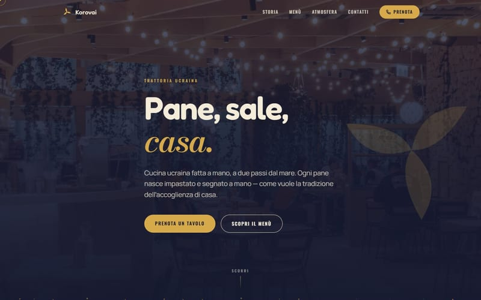</a>
 <b>Korovai</b> · Ukrainian trattoria
 <a href="https://palyanytsya-trattoria.vercel.app">Site</a> · <a href="https://github.com/LeoDex0/korovai-trattoria">Code</a>
</td>
<td width="50%" valign="top">
<a href="https://windows-style-trading.vercel.app">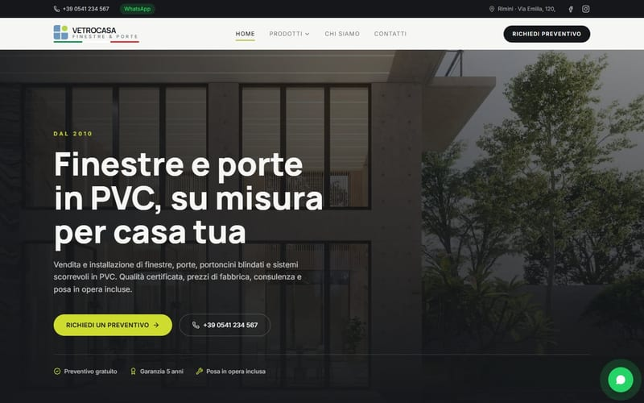</a>
 <b>VetroCasa</b> · Windows and doors company
 <a href="https://windows-style-trading.vercel.app">Site</a> · <a href="https://github.com/LeoDex0/vetrocasa">Code</a>
</td>
</tr>
<tr>
<td width="50%" valign="top">
<a href="https://rame-parrucchieri.vercel.app">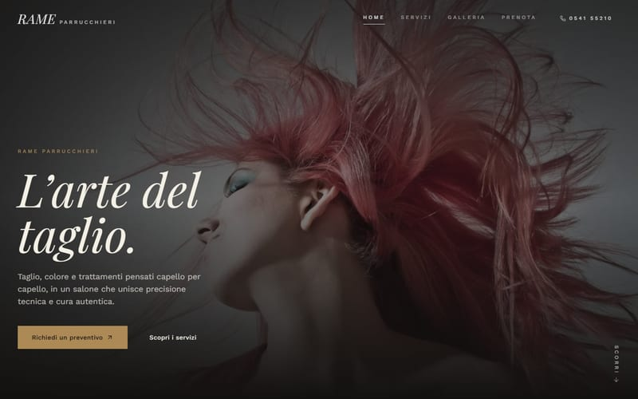</a>
 <b>Rame Parrucchieri</b> · Hair salon
 <a href="https://rame-parrucchieri.vercel.app">Site</a> · <a href="https://github.com/LeoDex0/rame-parrucchieri">Code</a>
</td>
<td width="50%" valign="top">
<a href="https://studio-nova-leo-dex.vercel.app">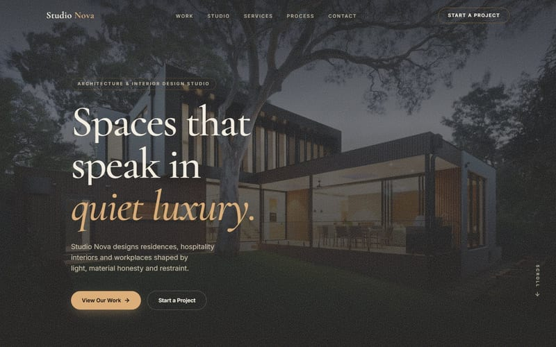</a>
 <b>Studio Nova</b> · Architecture studio
 <a href="https://studio-nova-leo-dex.vercel.app">Site</a> · <a href="https://github.com/LeoDex0/studio-nova">Code</a>
</td>
</tr>
<tr>
<td width="50%" valign="top">
<a href="https://studio-sestante.vercel.app">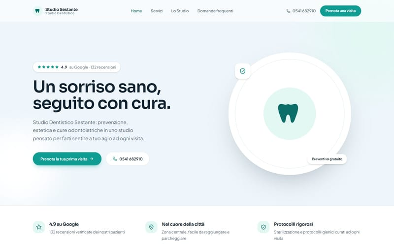</a>
 <b>Studio Sestante</b> · Dental clinic
 <a href="https://studio-sestante.vercel.app">Site</a> · <a href="https://github.com/LeoDex0/studio-sestante">Code</a>
</td>
<td width="50%" valign="top">
<a href="https://bloom-nail-bar-zeta.vercel.app">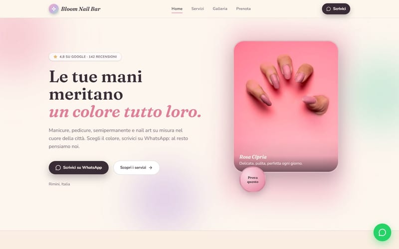</a>
 <b>Bloom Nail Bar</b> · Nail salon
 <a href="https://bloom-nail-bar-zeta.vercel.app">Site</a> · <a href="https://github.com/LeoDex0/bloom-nail-bar">Code</a>
</td>
</tr>
<tr>
<td width="50%" valign="top">
<a href="https://pulse-fit-three.vercel.app">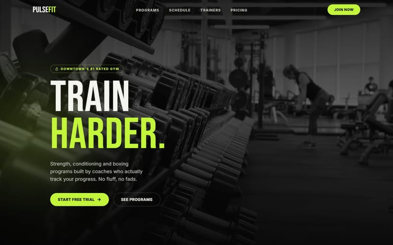</a>
 <b>PulseFit</b> · Gym
 <a href="https://pulse-fit-three.vercel.app">Site</a> · <a href="https://github.com/LeoDex0/pulse-fit">Code</a>
</td>
<td width="50%" valign="top">
<a href="https://prime-estate-puce.vercel.app">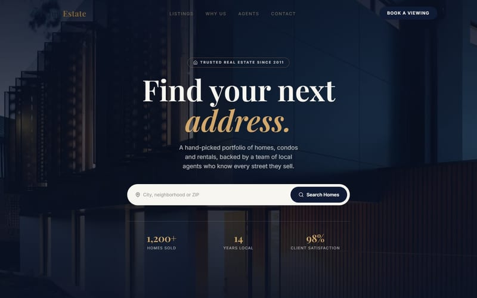</a>
 <b>PrimeEstate</b> · Real estate agency
 <a href="https://prime-estate-puce.vercel.app">Site</a> · <a href="https://github.com/LeoDex0/prime-estate">Code</a>
</td>
</tr>
</table>

### Tools

<table>
<tr>
<td width="50%" valign="top">
<a href="https://github.com/LeoDex0/paint-picker">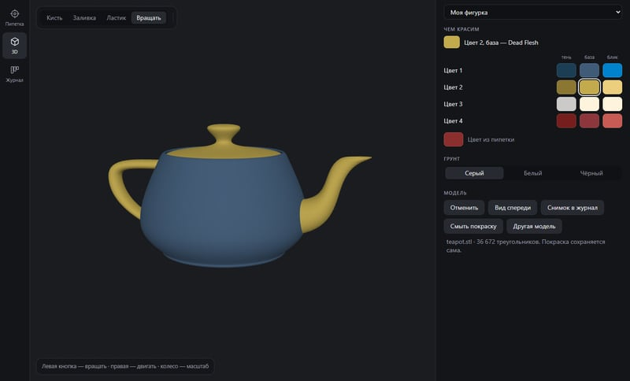</a>
</td>
<td width="50%" valign="top">
<b>Paint Picker</b>
 Windows app for painting 3D-printed miniatures.
  
Picks a color from a photo
 Finds the closest paints: Vallejo, Citadel, Army Painter, AK
 Shows how to mix a color from paints you have
 Lets you try the colors on the STL model in 3D
  
<a href="https://github.com/LeoDex0/paint-picker/releases/latest">Download</a> · <a href="https://github.com/LeoDex0/paint-picker">Code</a>
</td>
</tr>
</table>

### Just for fun

<table>
<tr>
<td width="50%" valign="top">
<a href="https://leodex-v2.vercel.app">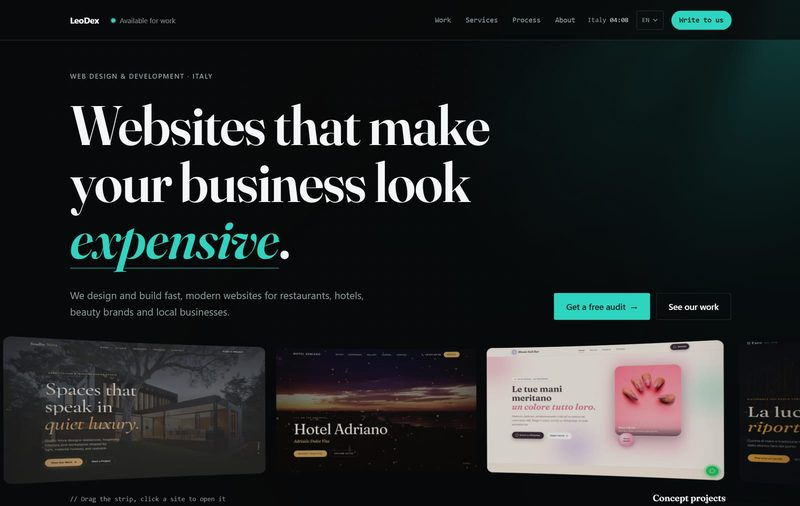</a>
</td>
<td width="50%" valign="top">
<b>leodex.dev v2</b>
 My own site, redone from scratch to try a different layout.
  
Drag the strip of sites on the first screen
 An old site gets fixed while you scroll
 Projects open inside a browser frame
 The terminal and its easter eggs are still there
  
<a href="https://leodex-v2.vercel.app">Site</a> · <a href="https://github.com/LeoDex0/leodex-v2">Code</a>
</td>
</tr>
</table>

### Stack

Next.js · React · TypeScript · Tailwind CSS · Astro · GSAP · Framer Motion · Three.js · Electron · Vercel
